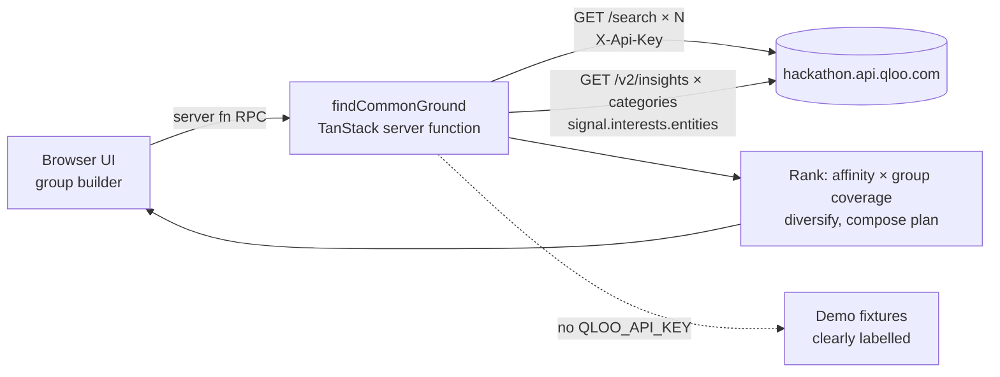

# CommonGround

**A group cultural discovery agent for the Qloo Agentic Hackathon.**
Friends, couples, families or teams each add 2–5 favorite artists, films, books, places, brands or games. CommonGround resolves them through Qloo, uses Qloo's taste intelligence to find shared recommendations, explains who each pick connects, and assembles a mini-plan.

## Architecture



- Frontend: TanStack Start + React + Tailwind (`src/routes/index.tsx`).
- Server: `src/lib/qloo.functions.ts` (`createServerFn`, runs on the server/edge worker). The API key is read from `process.env.QLOO_API_KEY` inside the handler and never sent to the browser.
- Input validated with Zod; every Qloo call has a 9s timeout; upstream errors are logged server-side and returned as safe messages.

## Qloo endpoints used

Host: `QLOO_API_BASE_URL` secret (default `https://hackathon.api.qloo.com`); requests are paced and retried on 429 · Header: `X-Api-Key: <QLOO_API_KEY>`

1. `GET /search?query=<text>&types=<urn>&take=1` — resolve each favorite to an entity ID. `types` is sent when the category maps (`urn:entity:artist|movie|book|place|brand|videogame`).
2. `GET /v2/insights?filter.type=<urn>&signal.interests.entities=<id,id,…>&feature.explainability=true&take=8[&filter.location.query=<city>]` — one call per target category for the chosen intent. Place requests are only made when a city is supplied.

Ranking: `groupScore = affinity × (0.5 + 0.5 × share of people whose favorites appear in query.explainability)`. Max 3 per category, 9 total. This is a transparent heuristic, not exact consensus.

## Local setup

```bash
bun install
QLOO_API_KEY=your_key bun run dev
```

## Lovable secret setup

Project Settings → Secrets → add `QLOO_API_KEY`. Reload the preview / republish. The status pill switches from **Demo data** to **Live Qloo** automatically.

## Demo mode

Without the key (or with "Use demo data" ticked), the server returns deterministic fixtures. Every demo card is prefixed `[Demo]`, badged DEMO, and the UI shows a setup banner. Demo results are never presented as Qloo data.

## Privacy

No accounts, emails or identifiers — optional nicknames only, used to label contributions.

## Hackathon submission checklist

- [ ] `QLOO_API_KEY` set in Secrets; status shows **Live Qloo**
- [ ] Run the demo group (New York, Weekend) end-to-end
- [ ] Publish the app and copy the public URL
- [ ] Record a ≤3 min demo video (builder → agent trace → cards → plan)
- [ ] Link this repo (MIT) and describe the Qloo usage above
