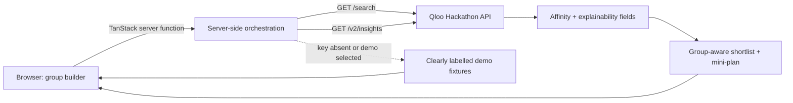

# CommonGround

**Find the overlap in your group's taste.** CommonGround is a group cultural discovery agent for the Qloo Agentic Hackathon. Friends, couples, families, or teams add a few favorite artists, films, books, places, brands, or games. CommonGround resolves those interests through Qloo, uses cultural affinity signals to build a shared shortlist, explains which inputs connect to each pick when Qloo provides explainability, and assembles a lightweight mini-plan.

> **Project status:** This repository contains a TypeScript/TanStack Start application. Laravel is not required to install, run, or build this project. See [README-LARAVEL.md](./README-LARAVEL.md) only if you need notes about an optional Laravel-based hosting or integration layer.

## Demo and source

- **Source:** https://github.com/LeadForge/shared-taste-scout
- **Hosted preview:** https://id-preview--0b8e6686-35e3-4345-bf7f-13a0675b7ce0.lovable.app
- **Hackathon:** Qloo Agentic Hackathon

The hosted URL above is the Lovable preview URL known at the time this README was prepared. Replace it with the final public deployment URL if a different production URL is used.

## Features

- Group builder for 2–5 participants with optional nicknames and 1–5 cultural interests per participant.
- Interest categories include artist/music, movie/TV, book, place/restaurant, brand, videogame, and other.
- Optional city and discovery intent.
- Server-side Qloo entity resolution through `GET /search`.
- Group recommendations through `GET /v2/insights`, using resolved entities as taste signals.
- Explainability-aware recommendation notes and a transparent affinity/group-coverage ranking heuristic.
- Short action trace showing the stages and API-call counts.
- Clearly labelled deterministic demo fixtures when the Qloo key is absent or demo mode is selected.
- No account, email, or personal identity information is required.

## Architecture



- **UI:** React + TanStack Start + Tailwind CSS.
- **Server:** `src/lib/qloo.functions.ts` uses TanStack Start server functions. Qloo credentials are read only in server-side handlers.
- **Validation:** Zod validates participant, interest, city, and intent input.
- **Demo data:** `src/lib/demo.ts` contains deterministic illustrative fixtures, explicitly not Qloo data.
- **Types and ranking:** `src/lib/types.ts` and `src/lib/engine.ts`.

## Requirements

Install these locally before starting:

- Node.js 20 or newer (use a current LTS release).
- Bun (the repository includes `bun.lock` and uses Bun commands below).
- A Qloo hackathon API key for live recommendations. A key is **not** needed to run the labelled demo mode.

Check your versions:

```bash
node --version
bun --version
```

## Run locally

1. Clone the repository and enter the project directory:

   ```bash
   git clone https://github.com/LeadForge/shared-taste-scout.git
   cd shared-taste-scout
   ```

2. Install dependencies:

   ```bash
   bun install
   ```

3. Create a local environment file named `.env` in the repository root. Do not commit this file:

   ```dotenv
   QLOO_API_KEY=replace_with_your_qloo_key
   QLOO_API_BASE_URL=https://hackathon.api.qloo.com
   ```

   The base URL above is the default Qloo hackathon host. If the hackathon supplied you a different server URL, use that exact base URL instead. Do not append `/search` or `/v2/insights` to the base URL.

4. Start the development server:

   ```bash
   bun run dev
   ```

5. Open the local URL printed by Vite (commonly `http://localhost:3000`).

### Run without a Qloo key

You can still install and explore the app in demo mode:

```bash
bun install
bun run dev
```

When `QLOO_API_KEY` is absent, the server returns deterministic sample fixtures. The interface labels these as demo data. Demo results are not live Qloo recommendations.

## Environment variables

| Variable | Required for | Description |
|---|---|---|
| `QLOO_API_KEY` | Live Qloo mode | API key supplied for the Qloo hackathon. Sent only as the `X-Api-Key` request header from the server. |
| `QLOO_API_BASE_URL` | Optional | Qloo API server base URL. Defaults to `https://hackathon.api.qloo.com` if not provided. |

**Security:** Never put the API key in a `VITE_*` variable, frontend source file, public config, README, issue, screenshot, or commit. Keep `.env` local and untracked. If a key is accidentally committed or shared, revoke/rotate it through the provider.

## Qloo request flow

1. `GET {QLOO_API_BASE_URL}/search` resolves each free-text favorite to an entity ID, using a mapped entity type where available.
2. Resolved IDs are combined into `signal.interests.entities`.
3. `GET {QLOO_API_BASE_URL}/v2/insights` requests candidates for selected recommendation types. A city filter is added for place recommendations when the user supplies a city.
4. Results are ranked using returned affinity and the share of participants connected through the explainability payload when present. This is a product heuristic, not a claim of mathematically exact group consensus.
5. The UI renders a shortlist and a deterministic mini-plan summary.

All calls are server-side and use the `X-Api-Key` header. The application does not need a separate LLM key for this deterministic workflow.

## Test and build

```bash
bun run test
bun run lint
bun run build
```

For a production preview after a successful build:

```bash
bun run preview
```

## Deploying with Lovable

The project is connected to Lovable. For hosted deployment:

1. Open the project in Lovable.
2. Add `QLOO_API_KEY` and `QLOO_API_BASE_URL` under project **Settings → Secrets**.
3. Keep the values server-side; do not add them to client-side environment variables.
4. Publish/redeploy after changing code or secrets, then check that the app's status indicates a verified live Qloo connection.
5. Run a real group query and confirm returned recommendations are live, not demo fixtures.

## Submission checklist

- [ ] Hosted demo URL opens without requiring the judge to install anything.
- [ ] A judge can use the demo group even if no API credentials are available to them.
- [ ] A live run has been tested with the hackathon Qloo key and the correct API server URL.
- [ ] Demo fixtures are visibly labelled and never represented as live Qloo output.
- [ ] No API key or other secret is present in Git history, screenshots, or the public repository.
- [ ] README and submission description accurately describe the implementation.
- [ ] Demo video and any additional materials match the actual submitted build.

## License

MIT. See [LICENSE](./LICENSE).
